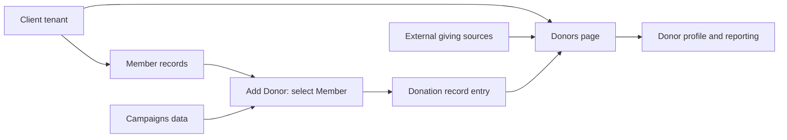

# Standalone AiXPurpose Donors — BRD Goals

| Document detail | Description |
|---|---|
| Status | Draft for review |
| Scope | Donor Management → Donors, with only necessary Members, Campaign, and donation dependencies |
| Evidence | User walkthrough and Donors screenshots (`image(20261009-111130).png`, `image(20261009-111809).png`, `image(20261009-112014).png`, `image(20261009-112113).png`, `image(20261009-112213).png`); standalone product decisions; Members BRD Goals/Workflow; `master_prompt_brd_goals.md` |
| Document boundary | Includes business context, outcomes, scope, actors, rules, product dependencies, proposals, decisions, and traceability. Excludes unsupported numeric success targets, legal regimes, detailed architecture, and full process specifications; operational and feature-level detail belongs in the Workflow and Feature Catalogue documents. |

## Overview
This document explains why the Donors page exists, the business outcomes it should support, and the boundaries of the Donors capability in Standalone AiXPurpose. It distinguishes confirmed behaviour from proposed enhancements and decisions that remain open.

## Contents
- [Overview](#overview)
- [Purpose and Business Context](#1-purpose-and-business-context)
- [Business Goals](#2-business-goals)
- [Product Scope and Positioning](#3-product-scope-and-positioning)
- [Actors and Business Relationships](#4-actors-and-business-relationships)
- [Confirmed Business Rules and Constraints](#5-confirmed-business-rules-and-constraints)
- [Capability Dependencies and Data Boundaries](#6-capability-dependencies-and-data-boundaries)
- [Proposed Enhancements and Authorised Assumptions](#7-proposed-enhancements-and-authorised-assumptions)
- [Open Questions and Decisions Required](#8-open-questions-and-decisions-required)
- [Relationship to Next BRDs](#9-relationship-to-next-brds)
- [Traceability and Validation Summary](#10-traceability-and-validation-summary)

## 1. Purpose and Business Context
The current AiXPurpose was designed for one organisation to consolidate donations and donor information arising from multiple external applications. **Standalone AiXPurpose** must support independent client organisations that rely on integrations, direct entry, or proposed spreadsheet imports, including clients primarily using donor lists and analytics. This document establishes *why* the Donors page exists and its approved boundaries; it does not treat screenshots as proof of unshown backend rules.

## 2. Business Goals
| Goal ID | Outcome-oriented goal | Basis / classification |
|---|---|---|
| BG-DON-001 | Provide a common Donors capability to multiple independent client organisations without exposing one tenant's records to another. | Confirmed standalone decision |
| BG-DON-002 | Present donor and giving information in a consolidated page regardless of supported originating source. | Confirmed business purpose; exact donor record-generation rules open |
| BG-DON-003 | Enable authorised users to capture a donation against a selected existing member and campaign without requiring external integrations. | Confirmed Add Donor interface and user account |
| BG-DON-004 | Enable users to find, segment, examine and review donor information through lists, tiers and advanced filters. | Confirmed prototype functionality |
| BG-DON-005 | Make donor KPIs useful for investigation by linking measures to relevant donor subsets. | User-proposed enhancement |
| BG-DON-006 | Support different organisations' donor recognition policies without fixing unapproved amount thresholds. | User-proposed organisation-configurable tier criteria |
| BG-DON-007 | Support review of donor giving, activity and scoring context from an individual donor profile. | Confirmed visible profile functions; scoring algorithms open |
| BG-DON-008 | Support extract and import-driven donor administration suitable for clients with no integrated donor source. | CSV export shown; donor bulk import proposed assumption |

No quantitative business success targets were supplied. The on-screen sample figures are not business targets or acceptance thresholds.

## 3. Product Scope and Positioning
### Confirmed or Currently Described
- Donors overview cards: Total Donors, Active Pledges, Retention Rate, and Prospects.
- Donor list with search, quick tier filters, Advanced Filters, record selection, CSV export, and row navigation. The list defaults to **All** tiers/all donors, as stated by the user.
- Add Donor modal and donor profile with giving summary, score breakdown, tabs, and actions.
- Shared global search, notifications, profile/sign-out, and AI Copilot entry point.

### Proposed or Assumption-Based Additions
These are not confirmed existing behaviours:
- Template-based Excel/CSV donor bulk import and post-import review.
- Clickable KPI list filtering and additional/client-relevant KPI choices.
- Organisation-definable donor tiers. Example boundaries are illustrative, *not* approved.
- Richer donor filter/export selection, subject to confirmation.

### Explicit Future
Donor communications, including campaign outreach/email, are future enhancements. The currently visible **Send Message** action does not establish that a full campaign communication programme is implemented or approved for core scope.

### Related Capabilities Outside This Document
Detailed specifications for Campaigns, Segments, Prospecting, Communications, Tasks, payment processing, and external integration administration are outside this document's boundary. Their interfaces to Donors are mentioned only when needed; these capabilities are not declared product-wide out of scope.

## 4. Actors and Business Relationships
| Actor / component | Established role | Not specified |
|---|---|---|
| Client organisation / workspace | Own isolated working context; same product features available to every tenant | Tenant provisioning model, account ownership |
| Administrator / application user | Reviews donors and uses visible donor actions as authorised | Detailed permissions and role definitions |
| Member record | Selected by name/email/phone in Add Donor | Whether every donor must be a member and conversion criteria |
| Campaigns data | Supplies Campaign dropdown values | Campaign eligibility and inactive campaign rules |
| External donation sources | Supply consolidated giving information for some clients | Connector specifications, source-of-truth and reconciliation |

## 5. Confirmed Business Rules and Constraints
| Rule ID | Rule | Provenance / qualification |
|---|---|---|
| BR-DON-001 | Every client uses an isolated tenant/workspace and can access only its own data. | Explicit product decision |
| BR-DON-002 | Every tenant receives the same product feature set. | Explicit product decision; permitted data/setting variation does not mean module enablement |
| BR-DON-003 | Donors listing uses **All** as its default tier selection. | Explicit user explanation |
| BR-DON-004 | Add Donor requires selection of an existing Member using name/email/phone lookup. | Add Donor screenshot, starred field; user explanation |
| BR-DON-005 | Donation Amount, Campaign, Payment Method and Donation Date are required in Add Donor; Notes has no visible required indicator. | Starred screenshot fields; no invented field-validation rules |
| BR-DON-006 | Campaign options in Add Donor come from the Campaigns page. | Explicit user explanation |
| BR-DON-007 | Clicking a donor row and the row's three-dot action reach the same donor detail/profile view. | Explicit user explanation |
| BR-DON-008 | Tier choices shown are All, Platinum, Gold, Silver and Bronze; *criteria assigning tiers are not confirmed*. | Screenshot and user description |
| BR-DON-009 | Advanced Filters present donation amount range, donor score (0–100), and engagement segments New Donors, Lapsing, Major Prospects, Monthly Donors. | Screenshot |
| BR-DON-010 | Current donor profile provides Overview, History, Engagement and Notes tabs with visible score components: Value (40%), Recency (30%), Frequency (30%), Engagement (Extra). | Screenshot; figures are visible labels, not an approved calculation algorithm |

## 6. Capability Dependencies and Data Boundaries

> This diagram shows user-described relationships, **not** an approved synchronisation or donor-conversion algorithm.

Donor profile scores, counts, statuses, tiers, and donation-source provenance need source/derivation rules before implementation.

## 7. Proposed Enhancements and Authorised Assumptions
| Ref | Classification | Proposal / business intent |
|---|---|---|
| AS-DON-001 | User-supplied assumption | Use predefined Excel/CSV donor import templates with mandatory fields; show import counts and permit administrator review/correction. |
| PE-DON-001 | Proposed enhancement | Make donor KPI cards act as filters on the donor list. |
| PE-DON-002 | Proposed enhancement | Make KPI selection available from data-backed choices to all tenants. |
| PE-DON-003 | Proposed enhancement | Define donor tier thresholds in organisation settings; user's >$100k Platinum and $50k–$100k Gold are *examples only*. |
| PE-DON-004 | Proposed enhancement | Consider additional filters and targeted/filtered export for donor review, subject to confirmation of exact scope. |
| FUT-DON-001 | Explicit future enhancement | Donor communications for campaign outreach and related messages. |

## 8. Open Questions and Decisions Required
| ID | Decision needed | Why it matters |
|---|---|---|
| OD-DON-01 | When is a Member represented as a Donor: on first donation, pledge, profile creation, or another rule? | List membership, counts and cross-page consistency |
| OD-DON-02 | What is the authoritative origin of imported/integrated donor and donation records and how are duplicates reconciled? | Consolidated giving accuracy |
| OD-DON-03 | What are the defined tier boundaries, currency, measurement period, recalculation cadence and owner of settings? | Consistent tier assignment |
| OD-DON-04 | What are the formulas/time windows for Retention Rate, Active Pledges, Prospects, Donor Score and its weighted components? | Trustworthy KPI/filter results |
| OD-DON-05 | Which payment methods are supported, how is a donation recorded versus processed, and what occurs after Save Donation? | Payment/record semantics; avoid inventing transactions |
| OD-DON-06 | What are the donor import template fields, duplicate rules, validation, error handling, partial import and tenant permissions? | Proposed bulk import specification |
| OD-DON-07 | What content and actions do History, Engagement, Notes, Add Task, and Send Message perform? | Profile workflow/Feature Catalogue limits |
| OD-DON-08 | Are export results filtered, selected, or complete by default? Which roles may export? | Disclosure controls and functional correctness |
| OD-DON-09 | What record-level access rights and tenant enforcement apply to donor list, profile and recording donations? | Multi-tenant privacy and permissions |
| OD-DON-10 | Which donor KPIs may be user-selected and how should overlapping filters combine? | Proposed dashboard behaviour |

## 9. Relationship to Next BRDs
**BRD Workflow** will elaborate donor navigation, search/filters, donation entry, donor profile, CSV export and proposed capabilities with evidence-labelled alternate/exception paths. **BRD Feature Catalogue** will identify independently testable functions and acceptance outcomes, without inventing unresolved policy. IDs trace as `BG-DON / BR-DON → WF-DON → DON-F`.

## 10. Traceability and Validation Summary
### Traceability
Goals BG-DON-001 through BG-DON-008 and rules BR-DON-001 through BR-DON-010 are grounded in the supplied discussions and UI, including clearly marked proposals.

### Validation Notes
- No numeric success target, donor score algorithm, permission matrix, or tier policy has been manufactured.
- Principal open decisions OD-DON-01 through OD-DON-10 require review before this BRD can be marked approved.
