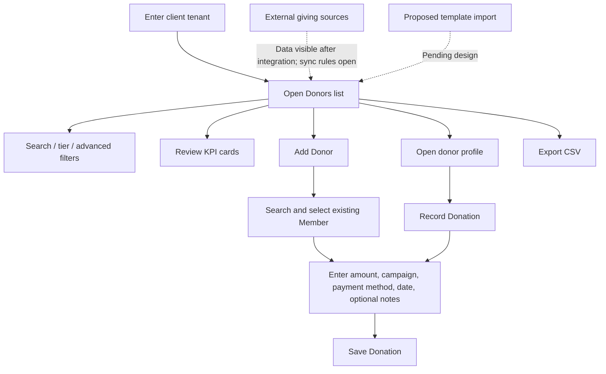
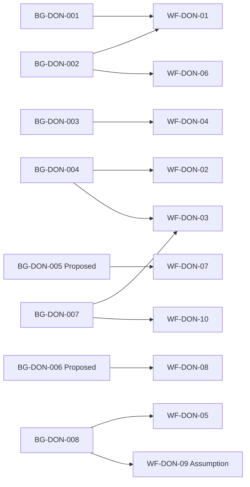

# Standalone AiXPurpose Donors — BRD Workflow

| Document detail | Description |
|---|---|
| Status | Draft for review |
| Basis | `Standalone_AiXPurpose_Donors_BRD_Goals.md`; supplied Donors prototype screenshots and user walkthrough; `master_prompt_brd_workflow.md` |
| Evidence key | **C:** confirmed-described UI/requirement; **A:** user assumption; **P:** proposal; **D:** derived implication; **O:** open decision |
| Scope note | UI visibility alone does not establish backend persistence or access authorisation. Unspecified notifications, audit logs, payment processing, and full cross-module flows are not invented. |

## Overview
This document translates the Donors business goals and rules into user-facing workflows. It covers the evidence sources, process overview, detailed workflow steps, traceability, screenshot mapping, feature handoff, and open decisions. Operational details that have not been established are explicitly marked as open rather than assumed.

## Contents
- [Overview](#overview)
- [Purpose, Actors and Boundaries](#1-purpose-actors-and-boundaries)
- [End-to-End Process Overview](#2-end-to-end-process-overview)
- [Workflow Inventory](#3-workflow-inventory)
- [Detailed Workflows](#4-detailed-workflows)
- [Goals-to-Workflow Traceability](#5-goals-to-workflow-traceability)
- [Screenshot and UI Evidence Mapping](#6-screenshot-and-ui-evidence-mapping)
- [Feature Catalogue Handoff](#7-feature-catalogue-handoff)
- [Decision Log and Validation Summary](#8-decision-log-and-validation-summary)

## 1. Purpose, Actors and Boundaries
Translate BG-DON-001…008 and BR-DON-001…010 into Donors page processes. **Actors:** application user/administrator, AiXPurpose in a client tenant, existing Member record, Campaigns data, and external donation source (where used). Exact role grants, connector design and source priority remain open. All tenants share the same product feature set but have isolated data and access (BR-DON-001/002).

## 2. End-to-End Process Overview

> The diagram reflects stated navigation and data entry. It does not assert that saving processes payment or automatically changes a member's status.

## 3. Workflow Inventory
| Workflow ID | Name | Key supporting Goals / Rules | Evidence |
|---|---|---|---|
| WF-DON-01 | Enter tenant and review donor summary | BG-DON-001/002, BR-DON-001/002/003 | C; access checks O |
| WF-DON-02 | Search and filter Donors list | BG-DON-004, BR-DON-003/008/009 | C |
| WF-DON-03 | Open and inspect donor profile | BG-DON-007, BR-DON-007/010 | C |
| WF-DON-04 | Add Donor / record donation | BG-DON-003, BR-DON-004/005/006 | C; post-save effect O |
| WF-DON-05 | Export Donors CSV | BG-DON-008 | C; export scope O |
| WF-DON-06 | Receive/consolidate external giving records | BG-DON-002 | C business purpose; integration mechanics O |
| WF-DON-07 | Donor KPI drill-down and KPI choice | BG-DON-005 | P |
| WF-DON-08 | Manage organisation-specific donor tiers | BG-DON-006, BR-DON-008 | P; thresholds O |
| WF-DON-09 | Bulk import donor/member-associated data | BG-DON-008, AS-DON-001 | A; details O |
| WF-DON-10 | Donor-profile adjacent actions | BG-DON-007 | C visible actions; destination behaviour O |

## 4. Detailed Workflows

### WF-DON-01 — Enter Tenant and Review Donor Summary
**Trace:** BG-DON-001/002; BR-DON-001/002/003; UI-DON-01. **Evidence:** C, access implementation O.  
**Trigger/actor:** Application user opens Donor Management → Donors in their organisation's workspace.
1. **User:** Opens Donors page. **System:** Displays donor KPI cards: Total Donors, Active Pledges, Retention Rate and Prospects (C).
2. **System:** Displays list with **All** tier selected and the donor records for the chosen context (C; exact authorisation mechanics O).
3. **User:** May use shared Search everything, notification bell, profile/sign-out or AI Copilot entry point (C; cross-module search and Copilot behaviour not fully specified).
**Outcome:** Donors overview is available within the client workspace. **Exception:** Cross-tenant denial and unauthorised roles require detailed decisions (OD-DON-09); do not infer mechanics.

### WF-DON-02 — Search and Filter Donors List
**Trace:** BG-DON-004; BR-DON-003/008/009; UI-DON-01/03. **Evidence:** C.  
**Trigger:** User needs a particular donor subset. **Precondition:** Donors list is visible.
1. User enters a **name, email or tier** in list search; system presents the corresponding filtered list (C).
2. User selects quick tier **All / Platinum / Gold / Silver / Bronze**; list shows the selected tier (C; tier assignment criteria O).
3. User selects **Advanced**; system opens the filter drawer (C).
4. User can specify **Minimum/Maximum Donation Range**, adjust **Donor Score** from 0–100, and choose engagement segments **New Donors / Lapsing / Major Prospects / Monthly Donors** (C).
5. User chooses **Apply Filters** to apply selected conditions or **Clear All** to clear them (C).
6. User can select row checkboxes (C; bulk action purpose O).
**Outcome:** List reflects the applied selection. **Open decisions:** filter combination, score boundary interpretation, empty list behaviour, multi-select semantics, whether list count/cards change and checkbox purpose (OD-DON-04/10).

### WF-DON-03 — Open and Inspect Donor Profile
**Trace:** BG-DON-004/007; BR-DON-007/010; UI-DON-02/04/05. **Evidence:** C.
1. User clicks a donor row **or** the row's three-dot action; both open the same donor profile (C).
2. System displays donor name, email, phone, location, Type, Tier, Status and Donor Score (C).
3. System displays **Lifetime Giving**, **Last Gift** and **Total Gifts** (C).
4. User switches between **Overview / History / Engagement / Notes** tabs (C). In Overview, system displays Value Score **(40%)**, Recency Score **(30%)**, Frequency Score **(30%)**, Engagement Score **(Extra)** (C: display labels; weighting/recalculation unverified).
5. User may access **Record Donation**, **Add Task** and **Send Message** actions (C visible). See WF-DON-04/10.
**Outcome:** Donor's on-screen profile is reviewable. **Unknowns:** score formula, data origin, detailed tab content, and discrepancy between example Total Gifts 0 and Lifetime Giving $8,900 (sample figures; OD-DON-04).

### WF-DON-04 — Add Donor / Record Donation
**Trace:** BG-DON-003; BR-DON-004/005/006; UI-DON-02. **Evidence:** C for UI/fields; post-save persistence specifics O.  
**Trigger:** User selects **Add Donor**, or starts donation entry from a donor profile / Member record (entry points are described; whether all share one form is to confirm).
1. User selects **Add Donor**; system opens the donation-entry modal (C).
2. User searches for an existing **Member by name, email or phone** and selects a member. The selector is marked required (C).
3. User provides **Donation Amount** (required), **Campaign** (required, populated from Campaigns), **Payment Method** (required; Credit Card displayed, UPI mentioned), **Donation Date** (required) and **Notes** (not marked required) (C).
4. User chooses **Save Donation**; system attempts the stated donation-record action (C intent). The exact success message, relationship created, ledger/payment effect, status update and error response are **not specified** (OD-DON-01/05).
5. Or user chooses **Cancel**; the modal offers this control (C; discard/unsaved-change policy not specified).
**Outcome:** Donation-entry submission is initiated for the selected member and campaign; final persisted-state rules must be confirmed. **Exceptions:** blank required fields visibly required, but validation wording and enforcement not established; no payment gateway behaviour should be inferred.

### WF-DON-05 — Export Donors CSV
**Trace:** BG-DON-008; UI-DON-01. **Evidence:** C action; scope O.
1. User opens Donors list and invokes **Export CSV** (C).
2. The requested capability exports donor list records to CSV (C user account); whether applied filters, row selections or all tenant donor rows determine inclusion is unspecified (OD-DON-08).
**Outcome:** CSV export is initiated. **Open:** included columns, sensitive fields, limits, role restrictions and treatment of current filters.

### WF-DON-06 — Receive / Consolidate External Giving Records
**Trace:** BG-DON-002; stand-alone product brief. **Evidence:** Confirmed business purpose, mechanics O.
1. External applications provide donor/donation information through existing integrations (C).
2. AiXPurpose presents consolidated donor/giving information for the organisation (C business outcome).
3. User reviews corresponding records in list/profile (C).
**Not specified:** integration schedule, field mapping, source attribution UI, synchronisation, identity matching, duplicate handling and record precedence (OD-DON-02). **Alternative:** clients may use manual donation capture (WF-DON-04) instead of relying on integrations.

### WF-DON-07 — Clickable KPIs and KPI Choice (Proposed)
**Trace:** BG-DON-005; PE-DON-001/002; UI-DON-01. **Evidence:** P.
1. User clicks a donor KPI, e.g. **Active Pledges**.
2. **Proposed:** system limits list to records relevant to that KPI.
3. **Proposed:** user chooses from available donor KPI options supported by their organisation's data.
**Open:** available KPI set, measures/definitions, persistent display choices, interaction with other filters and empty/unsupported measures (OD-DON-04/10). No final computation formula is implied.

### WF-DON-08 — Organisation-Specific Tier Criteria (Proposed)
**Trace:** BG-DON-006; BR-DON-008; PE-DON-003; UI-DON-01. **Evidence:** P.
1. Organisation establishes tier criteria (proposed; setter/approval process unconfirmed).
2. Tier labels continue to be **Platinum, Gold, Silver, Bronze** (C current UI).
3. **Proposed:** tier assignment/display and quick filtering follow approved organisational thresholds.
**Open:** who configures, ranges, boundary inclusivity, currency, time period, net vs gross giving, reassessment and effects on existing donor classifications (OD-DON-03). Illustrative $100k/$50k examples are not rules.

### WF-DON-09 — Template-Based Bulk Donor Import (Proposed Assumption)
**Trace:** BG-DON-008; AS-DON-001; supplied standalone direction. **Evidence:** A.
1. Administrator obtains a predefined donor template with mandatory fields (A).
2. Administrator prepares donor/member-related rows in Excel/spreadsheet/CSV and uploads a file (A).
3. **Proposed:** system validates the supplied fields and imports eligible records; administrator sees number imported (example: **250 donor records imported**) (A; validation logic not defined).
4. Administrator reviews and edits/corrects available donor information (A).
**Open:** whether import creates Members, Donors, donations, or links existing members; accepted headers, duplicate identity, all-or-nothing vs partial results, source tracking, remediation and authorisation (OD-DON-01/02/06). No unapproved automatic Member creation is implied.

### WF-DON-10 — Donor Profile Adjacent Actions
**Trace:** BG-DON-007; UI-DON-05. **Evidence:** C for action availability; O for behaviour.
1. On donor profile, user sees **Record Donation**, **Add Task** and **Send Message** (C).
2. **Record Donation** offers an entry point to donation capture for the particular donor (C user explanation; tie to WF-DON-04 requires exact route confirmation).
3. **Add Task** and **Send Message** are visible (C); destination form, outcome, permissions and notifications are not described.
**Boundary:** Campaign donor outreach is explicitly *future* (FUT-DON-001), not a documented core communications workflow.

## 5. Goals-to-Workflow Traceability
| Goal / Rule(s) | Workflow(s) | Status / qualification |
|---|---|---|
| BG-DON-001; BR-DON-001/002 | WF-DON-01, cross-cutting to all WFs | Tenant isolation confirmed; enforcement detail O |
| BG-DON-002 | WF-DON-01, WF-DON-06 | Integration results supported; matching logic O |
| BG-DON-003; BR-DON-004/005/006 | WF-DON-04 | Field selection and entry C; post-save semantics O |
| BG-DON-004; BR-DON-003/008/009 | WF-DON-02/03 | Visible list filtering / detail access C |
| BG-DON-005 | WF-DON-07 | Proposed KPI interaction |
| BG-DON-006 | WF-DON-08 | Proposed tier configuration |
| BG-DON-007; BR-DON-007/010 | WF-DON-03/10 | Profile and actions C; action details O |
| BG-DON-008 | WF-DON-05/09 | Export C; import A |

## 6. Screenshot and UI Evidence Mapping
Actual supplied assets are accessible with the indicated filenames. These are prototype evidence, not proof of persistence or permissions.

| ID | Screenshot file (same folder) | Visible evidence | Workflow support |
|---|---|---|---|
| UI-DON-01 | `image(20261009-111130).png` | Donors KPI cards, search, tier chips, Advanced, list, Export, Add Donor, row ellipsis | WF-DON-01/02/04/05/07/08 |
| UI-DON-02 | `image(20261009-111809).png` | Add Donor modal; Member selection, required donation fields, Notes, Cancel/Save | WF-DON-04 |
| UI-DON-03 | `image(20261009-112014).png` | Advanced Filters: range, score slider, segments, Clear All/Apply | WF-DON-02 |
| UI-DON-04 | `image(20261009-112113).png` | Profile identity/contact, giving cards, tabs, scores | WF-DON-03 |
| UI-DON-05 | `image(20261009-112213).png` | Profile score components and Record Donation, Add Task, Send Message actions | WF-DON-03/10 |

.png)
*UI-DON-01: Donors listing and high-level navigation.*

.png)
*UI-DON-02: Member-linked donation entry.*

.png)
*UI-DON-03: Advanced donor filtering controls.*

.png)
*UI-DON-04: Donor identity, KPIs, score and tabs.*

.png)
*UI-DON-05: Record Donation, Add Task and Send Message entry points.*

## 7. Feature Catalogue Handoff
| Workflow(s) | Candidate feature topics | Dependencies / decisions |
|---|---|---|
| WF-DON-01 | Tenant-context listing, KPI cards, global header entry points | OD-DON-04/09 |
| WF-DON-02 | List search, tier chips, advanced filter drawer, Apply/Clear, row selection | OD-DON-03/04/10 |
| WF-DON-03 | Donor detail navigation, contact/type/tier/score, giving cards, tabs | OD-DON-04/07 |
| WF-DON-04 | Member lookup, donation fields, Campaign lookup, Save/Cancel | OD-DON-01/05/09 |
| WF-DON-05 | CSV export | OD-DON-08 |
| WF-DON-06 | Integration-sourced donor data presentation | OD-DON-02 |
| WF-DON-07/08 | KPI drill-down/selection; tier policy configuration | OD-DON-03/04/10; proposed |
| WF-DON-09 | Template import and post-import review | OD-DON-01/02/06; assumption |
| WF-DON-10 | Record Donation / Add Task / Send Message entry points | OD-DON-05/07; communications future |

## 8. Decision Log and Validation Summary
See **OD-DON-01…10** in the Goals BRD. They remain open; no workflow may claim a settled donor-conversion rule, numeric donor tier thresholds, score formula, payment processing integration, import reconciliation policy or access matrix. Ten workflow entries are mapped to goal/rule authority, including clearly labelled proposed and assumption-based flows. Detailed Feature Catalogue is the next deliverable; feature IDs will be assigned there, not invented as workflow evidence.
