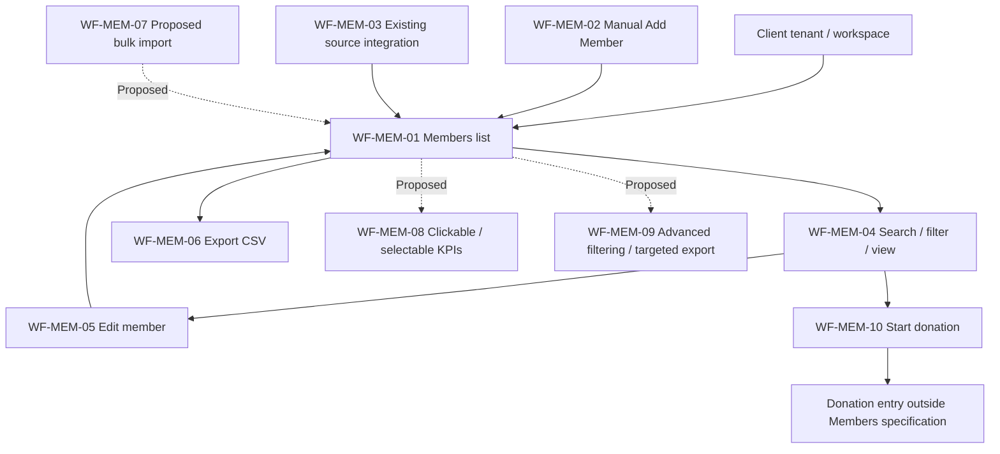
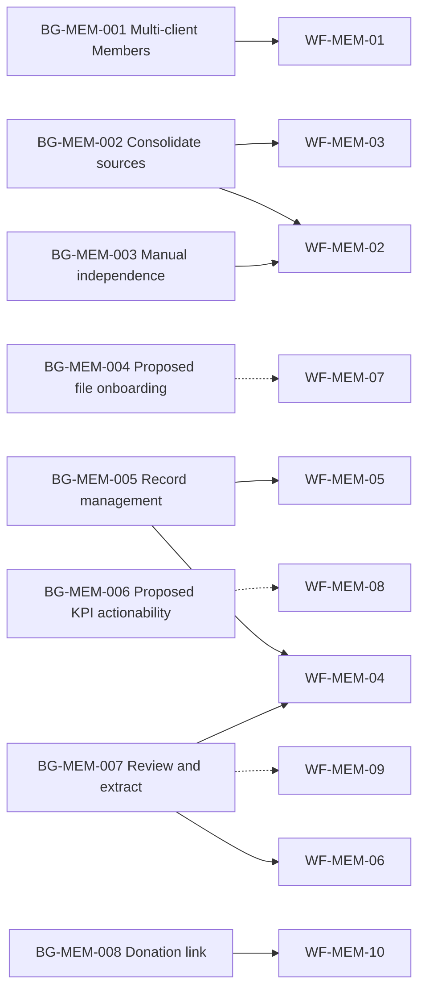
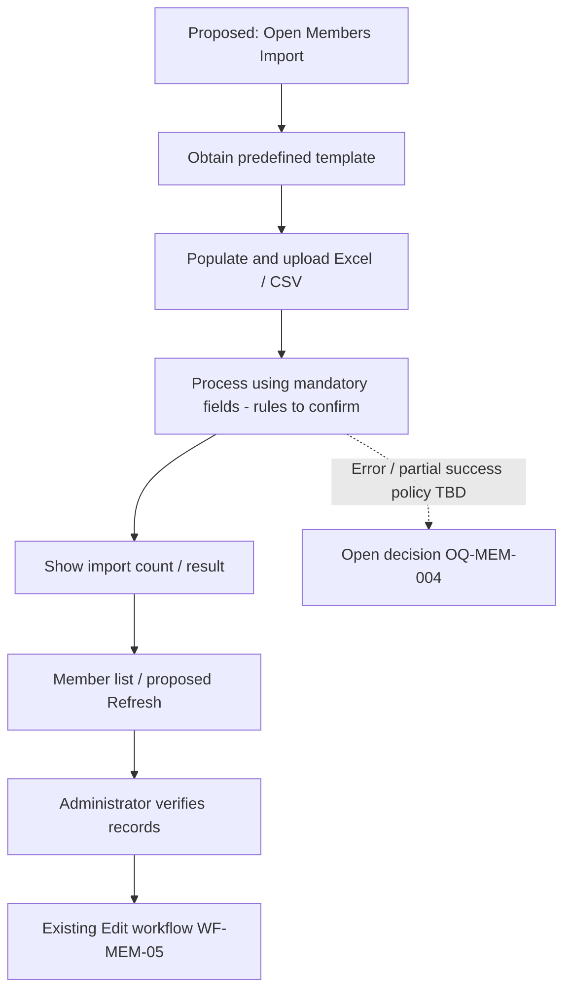

# Standalone AiXPurpose Members — BRD Workflow

| Document detail | Description |
|---|---|
| Status | Draft for business and technical review |
| Scope | Donor Management → Members, including the essential donation-entry handoff |
| Business-intent source | `Standalone_AiXPurpose_Members_BRD_Goals.md` |
| Source evidence | User Members walkthrough and screenshots (`image(20261009-094934).png`, `image(20261009-101351).png`, `image(20261009-110406).png`); approved standalone-product decisions; `master_prompt_brd_workflow.md` |
| Document boundary | Includes scope, evidence conventions, actor boundaries, workflow inventory, process and goal-link diagrams, detailed flows, shared rules, screenshot mapping, traceability, Feature Catalogue handoff, open decisions, and validation. Detailed technical architecture, invented permission matrices, unapproved validations, full donation processing, and unrelated module workflows are omitted. |

## Overview
This document explains how the Members capability supports the outcomes defined in the BRD Goals. It describes the user-facing workflows and distinguishes confirmed behaviour from assumptions, proposals, and open decisions. Atomic feature acceptance criteria belong in the BRD Feature Catalogue.

## Contents
- [Overview](#overview)
- [Purpose, Boundaries and Evidence](#1-purpose-boundaries-and-evidence)
- [Actors and Shared Rules](#2-actors-and-shared-rules)
- [Workflow Inventory](#3-workflow-inventory)
- [Detailed Member Workflows](#4-detailed-member-workflows)
- [UI Evidence Mapping](#5-ui-evidence-mapping)
- [Goals-to-Workflow Traceability](#6-goals-to-workflow-traceability)
- [Feature Catalogue Handoff](#7-feature-catalogue-handoff)
- [Open Decisions and Contradictions](#8-open-decisions-and-contradictions)
- [Validation Summary](#9-validation-summary)

## 1. Purpose, Boundaries, and Evidence

This document explains **how** the Members capability supports the outcomes in BRD Goals. It does not redefine business goals or specify the atomic acceptance criteria reserved for the BRD Feature Catalogue.

- **Confirmed standalone constraints:** Each client operates in an isolated tenant/workspace (`BR-MEM-001`); all clients receive the same product feature set (`BR-MEM-002`). No physical database architecture is prescribed.
- **Existing Members scope:** Integrated and manually entered members; list, search, donor type/status filters, pagination, CSV export, create/edit/view, profile KPIs, and donation-entry navigation.
- **Proposed enhancements:** Template-based Excel/CSV import and correction, Import/Refresh controls, clickable/user-selectable KPIs, additional filters and filtered export. These are *not* presented as currently implemented.
- **Boundary:** The Donors page, donation payment processing, Campaigns, Segments, Prospecting, integrations administration and Copilot conversation logic are separate functional specifications. Donation initiation and campaign-field dependencies are mentioned only where they affect Members.
- **Future only:** Donor communication/campaign outreach (`BR-MEM-008`).

**Evidence labels:** **C** = confirmed from user description; **A** = explicitly suggested assumption/enhancement; **D** = derived implication, requiring confirmation where it adds behaviour; **O** = open decision. A screenshot establishes visible UI, not persisted backend behaviour, access authorisation, validations, or state transitions.

## 2. Actors and Shared Rules

| Actor / system | Documented responsibility | Boundary |
|---|---|---|
| Administrator | Enter/edit member data; intended reviewer of imports and corrections | Precise role permissions not supplied (`OQ-MEM-005`) |
| Application user | Navigate, inspect, search, filter and export where authorised | Role access is not defined |
| AiXPurpose Members capability | Present tenant's Members records and supported controls | Source matching/merge and refresh semantics not defined |
| External source application | Supply member data through an existing integration | Connectors, sync frequency and reconciliation unspecified |
| Donation entry capability | Destination for `$` / **Add Donation** | Payment processing and saved-record associations belong to related workflow |

**Shared rules inherited from Goals:** isolated client data and access (`BR-MEM-001`); common feature set (`BR-MEM-002`); integrated/manual sources (`BR-MEM-003`); active-member default listing (`BR-MEM-004`); row click = View (`BR-MEM-005`); Edit uses the prefilled Add Member form structure (`BR-MEM-006`); `$` and Add Donation initiate donation entry (`BR-MEM-007`). **Active** is not yet mapped to the status dropdown values. No unsupported record-status transitions are defined.

## 3. Workflow Inventory

| ID | Workflow | Trigger | Goal / rule trace | Evidence |
|---|---|---|---|---|
| WF-MEM-01 | Access tenant Members list | User opens Members | BG-MEM-001, BG-MEM-005; BR-MEM-001/002/004 | C; authorisation details O |
| WF-MEM-02 | Add member manually | Select **Add Member** | BG-MEM-002/003/005; BR-MEM-003 | C; validation O |
| WF-MEM-03 | Receive integration-fed members | External source supplies member data | BG-MEM-002; BR-MEM-003 | C; matching/sync O |
| WF-MEM-04 | Find and inspect members | Search, filter, paginate, select row/View | BG-MEM-005/007; BR-MEM-004/005 | C |
| WF-MEM-05 | Edit existing member | Select Edit | BG-MEM-005; BR-MEM-006 | C; save/conflict policy O |
| WF-MEM-06 | Export Members list | Select Export CSV | BG-MEM-007 | C; exact export population O |
| WF-MEM-07 | Import member file and review | Proposed Import action | BG-MEM-004; PE-MEM-001–003 | **A**; rules O |
| WF-MEM-08 | KPI-guided exploration | Proposed KPI card / configuration | BG-MEM-006; PE-MEM-004/005 | **A**; KPI logic O |
| WF-MEM-09 | Additional filters and targeted export | Proposed enhanced filters/export | BG-MEM-007; PE-MEM-006/007 | **A**; options O |
| WF-MEM-10 | Start donation from member | Select `$` or profile Add Donation | BG-MEM-008; BR-MEM-007 | C; downstream outcome O |

### 3.1 Connected Process Overview

### 3.2 Goals-to-Workflows Mapping

*Dashed edges represent proposed functionality, not implemented behaviour.*

## 4. Detailed Member Workflows

### WF-MEM-01 — Access Members in the Client Workspace

- **Goal/rules:** BG-MEM-001/005; BR-MEM-001/002/004. **Evidence:** C; access checks O.
- **Trigger / actor:** Application user navigates to **Donor Management → Members**.
- **Main path:** (1) User accesses their client workspace. (2) User opens Members. (3) AiXPurpose presents that tenant's member listing with **active members by default**, four existing KPIs (**Total Members, Conversion Ready, Email Verified, Phone Verified**), list controls and pagination. (4) User may proceed to other Members workflows.
- **Outcome:** A tenant-scoped Members page is displayed.
- **Decisions / exceptions:** Meaning of *active*, precise roles, and inaccessible-record handling are not defined (`OQ-MEM-002/005`). Tenant isolation is confirmed; specific access-control implementation is not.
- **UI:** UI-01, UI-02. **Catalogue handoff:** workspace data boundary, list initialisation, default subset, navigation and visible KPIs.

### WF-MEM-02 — Create a Member Manually

- **Goal/rules:** BG-MEM-002/003/005; BR-MEM-003. **Evidence:** C; field mandatory/validation rules O.
- **Trigger / actor:** Administrator selects **Add Member**.
- **Main path:** (1) The member-entry form opens. (2) Administrator enters applicable details in five groups:

  | Form group | Fields supplied by user |
  |---|---|
  | Constituent Contact Information | Donor Type (Individual / Organisation / Foundation), Title, First Name, Last Name, Email, Phone Number |
  | Address and Communication | Address, ZIP Code, State, City, Anonymous Donor, Do Not Solicit |
  | Campaign & Giving | Current Campaign, Current Status (Prospect / Pledge / Donated or Donation / Lapsed), Current Solicitor, Pledged Amount |
  | Recognition & Social | Donor Publication, Spouse Last Name, Spouse Middle Name, Alternate Phone 1, Alternate Phone Type 1 (e.g. Home / Work), Alternate Phone 2 |
  | Advanced / System Fields | iWave Score, Capacity Score, Propensity Score, Affinity Score, Profile URL, Name of First Guest, Name of Second Guest, Previous Home Number, Alternate Phone Type 2 |

  (3) Administrator completes the page's member-creation action. (4) The created record appears in the Members data set/list **subject to the active-only default list filter**.
- **Outcome:** Manually entered member information becomes available through Members.
- **Decisions / exceptions:** Mandatory fields, uniqueness, validation messages, cancellations, status assignment, field applicability by donor type and whether a newly created non-active member appears immediately are **open** (`OQ-MEM-001/002/003`). No required-field markers or failure outcomes are invented.
- **UI:** UI-02 (listing/navigation); form fields are provided in the user's description. **Catalogue handoff:** form groups, inputs, form submission, save/result behaviour and validation decisions.

### WF-MEM-03 — Receive Member Data from an Existing Integration

- **Goal/rules:** BG-MEM-002; BR-MEM-003. **Evidence:** C for source and listing outcome; specific transfer path O.
- **Trigger / actor:** A supported external application provides member information to AiXPurpose.
- **Main path:** (1) Member data originates from an integrated application. (2) AiXPurpose receives member details through its existing integration capability. (3) Related member information becomes available in the consolidated Members listing and individual profile (depending on its populated fields and default filter).
- **Outcome:** Administrators need not inspect each source application separately to view consolidated member information.
- **Decisions / exceptions:** Supported sources, sync timing, matching/duplicates, whether imported records update existing manually entered records, source precedence, missing values, failure reporting and cross-tenant data mapping are unspecified (`OQ-MEM-009`). Do not assume automatic merge logic.
- **UI:** UI-02, UI-03. **Catalogue handoff:** source record ingestion and display, record linkage and provenance decisions.

### WF-MEM-04 — Search, Filter, Paginate and View a Member

- **Goal/rules:** BG-MEM-005/007; BR-MEM-004/005. **Evidence:** C.
- **Trigger / actor:** User interacts with the Members listing.
- **Main path:** (1) User sees the default active-member list. (2) User optionally searches by **name, email or phone**. (3) User optionally applies **Donor Type** (Individual, Organisation, Foundation) or **Status** (Prospect, Pledge, Donation/Donated, Lapsed) filters. (4) User navigates paginated results. (5) User clicks a row **or** its **View** icon. (6) Both actions open the **same Member Detail/Profile page**, showing saved/received fields and summary cards **Total Donations**, **Pledged Amount 2024**, **iWave Score**.
- **List columns:** Name; Donor Type; Contact; Location; Member Status; Pledged 2024; Created; Actions.
- **Alternate path:** Global **Search Everything** can locate information beyond Members, e.g. donor/campaign details; its result routing is a shared-application dependency, not defined here.
- **Outcome:** Requested member information is displayed.
- **Decisions / exceptions:** Filter combination rules, no-result handling, status terminology, active-only default interaction, pledge-year selection, and global-search permissions are unspecified (`OQ-MEM-002/005/010`).
- **UI:** UI-02, UI-03. **Catalogue handoff:** list columns, search scope, dropdowns, paging, profile navigation/cards.

### WF-MEM-05 — Edit / Complete an Existing Member

- **Goal/rules:** BG-MEM-005; BR-MEM-006. **Evidence:** C.
- **Trigger / actor:** Administrator selects **Edit** on a member row or profile.
- **Main path:** (1) AiXPurpose opens the **same five-section form structure as Add Member**, populated with the selected member's existing values. (2) Administrator fills missing fields or changes existing information. (3) Administrator completes the update action. (4) Subsequent viewing shows the updated record information.
- **Outcome:** An existing member's details can be corrected or completed without creating a separate member profile.
- **Decisions / exceptions:** Required fields, edit permissions, concurrent edits, audit history, integration re-sync overwriting manual changes, save failures and cancellation are not defined (`OQ-MEM-003/005/009`).
- **UI:** UI-02, UI-03. **Catalogue handoff:** prefilling, editable fields, persist/update behaviour and access rules.

### WF-MEM-06 — Export Members to CSV

- **Goal:** BG-MEM-007. **Evidence:** C for CSV export; exported subset O.
- **Trigger / actor:** User selects **Export CSV** from Members.
- **Main path:** (1) User opens Members and may use existing search/filter controls. (2) User selects **Export CSV**. (3) AiXPurpose provides a CSV extract of member records.
- **Outcome:** Member data is available as a CSV file.
- **Decisions / exceptions:** The existing export's exact record scope (all, active-only, visible page, filtered selection), column set, role permissions and empty-result behaviour are **not supplied**. **Exporting only a chosen filtered subset** is a separate proposal in WF-MEM-09, not an assumed existing rule.
- **UI:** UI-02. **Catalogue handoff:** export activation, scope, columns and authorisation decision.

### WF-MEM-07 — Proposed Template-Based Bulk Import and Review

- **Goal/proposals:** BG-MEM-004; PE-MEM-001/002/003. **Evidence: A (authorised product proposal; not implemented/approved existing flow).**
- **Trigger / actor:** Administrator chooses a proposed **Import** action on Members.
- **Proposed main path:** (1) Administrator obtains a predefined Members template. (2) Administrator populates it with member records and mandatory columns. (3) Administrator uploads an Excel/spreadsheet/CSV file. (4) AiXPurpose processes the submitted data and presents an import result count, e.g. **“250 member records imported”** when 250 were successfully imported. (5) Successfully added members become accessible in Members; proposed **Refresh** allows reloading the list. (6) Administrator cross-verifies member data and uses **Edit** to correct or complete records.
- **Proposed alternative:** Where source data has omissions, administrator reviews and corrects affected records. **Whether missing mandatory data blocks a row, blocks the file or permits partial success is unresolved.**
- **Outcome sought:** Bulk member onboarding without individual manual entry.
- **Open decisions:** Template fields and format constraints, create-versus-update, duplicates, row-level errors, count meanings, rollback, access, file size, and whether/how incomplete records can be imported (`OQ-MEM-004/005/009`). Do **not** specify a silent failure-recovery strategy.
- **Catalogue handoff:** template/download, upload, validation decisions, results, review, refresh, correction.

### WF-MEM-08 — Proposed Clickable and User-Selected KPIs

- **Goal/proposals:** BG-MEM-006; PE-MEM-004/005. **Evidence: A.**
- **Trigger / actor:** User selects a displayed KPI, or chooses which KPIs appear.
- **Proposed main path:** (1) Existing Members header displays **Total Members**, **Conversion Ready**, **Email Verified**, **Phone Verified**. (2) User may choose from an available list of KPI cards to display. (3) Clicking a KPI filters the Members list to records satisfying that KPI: e.g. **Phone Verified** displays members whose phones are verified. (4) User reviews matching members through list actions.
- **Outcome sought:** Summary measures directly drive relevant record review.
- **Open decisions:** Additional KPI catalogue, formula/data inputs (especially Conversion Ready), whether selected KPIs persist by user, interaction with existing filters, missing verification values, and reset behaviour (`OQ-MEM-006`). This does not imply all KPI calculations are already implemented as drill-downs.
- **Catalogue handoff:** KPI catalogue, selection state, membership criteria, drill-down and filter interactions.

### WF-MEM-09 — Proposed Additional Filters and Targeted Export

- **Goal/proposals:** BG-MEM-007; PE-MEM-006/007. **Evidence: A.**
- **Trigger / actor:** User requests a subset such as members from a specific location.
- **Proposed main path:** (1) User opens Members. (2) User applies available additional filters, such as **Location** if approved and available. (3) Members list narrows to matching records. (4) User chooses Export CSV for the **selected filtered subset**. (5) AiXPurpose provides the targeted extract.
- **Outcome sought:** A client can review/export relevant member populations without exporting unrelated records.
- **Open decisions:** Additional filter list, filter combination semantics, export selection/scope, permissions and default reset behaviour (`OQ-MEM-005/007`).
- **Catalogue handoff:** filters, selection criteria, targeted export output.

### WF-MEM-10 — Initiate a Donation from Member Context

- **Goal/rule:** BG-MEM-008; BR-MEM-007. **Evidence:** C for navigation, downstream association O.
- **Trigger / actor:** User selects the **$** icon on a member row or **Add Donation** on a member profile.
- **Main path:** (1) User identifies the intended member. (2) User chooses either donation action. (3) AiXPurpose navigates to the Donation page/entry workflow. (4) Donation details can then be entered under the separate Donors/Donation capability.
- **Outcome:** Donation entry is initiated from the selected member's context.
- **Decisions / exceptions:** Whether the member is automatically preselected, what donation fields or payment outcomes are required, whether a successful gift updates member status, pledge amount or KPIs, and how donation source is displayed remain open (`OQ-MEM-001/008`). Nothing in this document asserts a completed payment or donation on navigation.
- **UI:** UI-02, UI-03. **Catalogue handoff:** actions/navigation, context transfer and donor/donation association after confirmation.

## 5. UI Evidence Mapping

| UI ID | Supplied screenshot | What it supports | Related workflows | Evidence limitation |
|---|---|---|---|---|
| UI-01 | `image(20261009-094934).png` | Overall application sidebar; Donor Management includes Members and Donors | WF-MEM-01 | Navigation only; no access-policy proof |
| UI-02 | `image(20261009-101351).png` | Members listing, KPIs, filters, actions and Export CSV / Add Member | WF-MEM-01/02/04/05/06/10 | Does not establish field validation, export scope or backend sync |
| UI-03 | `image(20261009-110406).png` | Member profile and summary KPIs, Edit and Add Donation actions | WF-MEM-03/04/05/10 | Does not prove donation payment completion or source provenance |

**Packaging note:** Original screenshot filenames are preserved as source references. Images are not embedded in this single-file Markdown deliverable because a standalone `.md` cannot reliably depend on the original chat attachment paths. They can be packaged as supporting assets if requested.

## 6. Goals-to-Workflow Traceability

| Goal / rule | Supporting workflow(s) | Basis / remaining decision |
|---|---|---|
| BG-MEM-001; BR-MEM-001/002 | WF-MEM-01; boundary across WF-MEM-02–10 | Tenant isolation confirmed; role/access implementation open |
| BG-MEM-002; BR-MEM-003 | WF-MEM-02/03 | Integrated and manual data confirmed; matching unresolved |
| BG-MEM-003 | WF-MEM-02 | Manual entry enables use without integrations |
| BG-MEM-004; PE-MEM-001–003 | WF-MEM-07 | **Proposed** file import; rules open |
| BG-MEM-005; BR-MEM-004/005/006 | WF-MEM-01/04/05 | Active default, View equivalence and prefilled Edit confirmed |
| BG-MEM-006; PE-MEM-004/005 | WF-MEM-08 | **Proposed** KPI interactions; calculation policy open |
| BG-MEM-007; PE-MEM-006/007 | WF-MEM-04/06/09 | Existing discovery and export; targeted export **proposed** |
| BG-MEM-008; BR-MEM-007 | WF-MEM-10 | Donation navigation confirmed; association open |
| BR-MEM-008 | All applicable workflows | Donor communications remain a **future** enhancement; no current execution workflow |

## 7. Feature Catalogue Handoff

| Workflow | Feature topics to define next | Decision dependencies |
|---|---|---|
| WF-MEM-01/04 | Tenant-scoped listing, default dataset, columns, search, filters, pagination, row/View navigation, profile cards | OQ-MEM-002/005/010 |
| WF-MEM-02/05 | Five form sections, input fields, prefilled editing, submission/update, field applicability | OQ-MEM-003/005/009 |
| WF-MEM-03 | Integration-fed record visibility, identifiers, update/reconciliation, source attribution | OQ-MEM-009 |
| WF-MEM-06/09 | CSV generation; **proposed** extra filters/selected-subset export | OQ-MEM-005/007 |
| WF-MEM-07 | **Proposed** templates, bulk upload, field checks, import counts, review and refresh | OQ-MEM-004/005/009 |
| WF-MEM-08 | **Proposed** KPI choice, click-through criteria and filter combinations | OQ-MEM-006 |
| WF-MEM-10 | `$` and Add Donation navigation, member context passed to donor/donation flow | OQ-MEM-001/008 |

No final Feature Catalogue IDs or unsupported acceptance criteria are assigned here.

## 8. Open Decisions and Contradictions

| ID | Decision needed | Affects |
|---|---|---|
| OQ-MEM-001 | Define Member vs Donor, Prospect and converted/donated member; establish associated status transitions, if any. | WF-MEM-02/04/10 |
| OQ-MEM-002 | Define **Active** versus Prospect/Pledge/Donated/Lapsed and how status filtering overrides the default. | WF-MEM-01/02/04 |
| OQ-MEM-003 | Confirm manual-entry mandatory fields, field variations by donor type, and validation/cancellation. | WF-MEM-02/05 |
| OQ-MEM-004 | Approve import template columns, error handling, duplicate/update rules, partial success, and corrective re-import. | WF-MEM-07 |
| OQ-MEM-005 | Define role/record permissions for view, create, edit, import, export and donation initiation. | All member user workflows |
| OQ-MEM-006 | Specify KPI definitions, selectable KPI list, click-filter interaction and reset. | WF-MEM-08 |
| OQ-MEM-007 | Specify extra filters, combination behaviour, filtered export and scope of existing CSV. | WF-MEM-06/09 |
| OQ-MEM-008 | Confirm selected-member prefill and donation effects on Member status/KPIs. | WF-MEM-10 |
| OQ-MEM-009 | Identify supported connectors, sync, identity matching, data precedence and provenance. | WF-MEM-03/05/07 |
| OQ-MEM-010 | Decide the reusable period for **Pledged 2024 / Pledged Amount 2024**. | WF-MEM-01/04 |
| OQ-MEM-011 | Set measurable business success targets if required. | Goals-level decision; not a workflow gate |

**Terminology conflicts:** User descriptions alternate between **Donation** and **Donated** and between **Pledge** and **Pledged**; preserve these as unapproved variations. **Active-only** default is not reconciled with those status categories. Neither is silently resolved.

## 9. Validation Summary

| Area | Summary |
|---|---|
| Workflow inventory | 10 Members workflows: six grounded in existing page/source interactions (including shared access and integration boundaries), three proposed enhancements, and one confirmed donation handoff. Classification follows each workflow's evidence label and does not claim deployment status. |
| Traceability | Each workflow maps to `BG-MEM-*`, a confirmed rule, or a labelled proposal. The tenant and future communication boundaries remain consistent with Goals, and the goal-to-workflow diagram distinguishes proposals. |
| Evidence | Three supplied application screenshots are mapped by source filename with explicit limitations; user descriptions support details that screenshots cannot verify. |
| Material decisions | Member/status definitions, access authorisation, import policy, integration merging, KPI rules, export scope, and donation linkage require confirmation. No fabricated outcomes, state machines, security controls, or error-recovery policies are introduced. |
| Next document | **Members BRD Feature Catalogue**, derived from validated workflows and approved decisions rather than invented specifications. |
